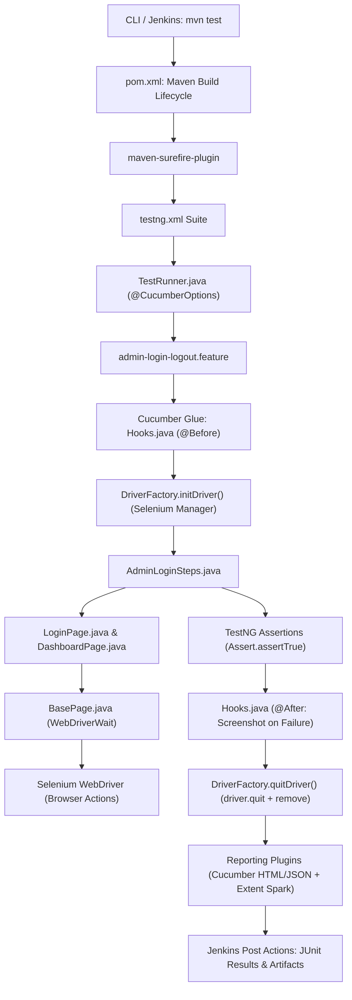

# 🚀 Lakshya HRMS BDD UI Automation Framework

An enterprise-grade, independent UI automation framework built from scratch using **Java 17, Selenium 4, Cucumber BDD 7, TestNG, Maven, and Jenkins CI/CD**.

Target Application: **Lakshya Visits — Web Portal** ([https://lakshya.zfourhr.in](https://lakshya.zfourhr.in))  
Authentication Flow: `Admin Email → Continue → 6-Digit OTP Distribution → Dashboard Validation → Profile Menu → Logout → Login Verification`

---

## 📑 Table of Contents
1. [Project Overview](#1-project-overview)
2. [Complete Framework Architecture](#2-complete-framework-architecture)
3. [The Complete Execution Flow (Step-by-Step)](#3-the-complete-execution-flow-step-by-step)
4. [Maven Command: Word-by-Word Breakdown](#4-maven-command-word-by-word-breakdown)
5. [pom.xml Deep Dive](#5-pomxml-deep-dive)
6. [Maven Surefire & testng.xml](#6-maven-surefire--testngxml)
7. [TestRunner.java Line-by-Line](#7-testrunnerjava-line-by-line)
8. [Jenkinsfile Line-by-Line](#8-jenkinsfile-line-by-line)
9. [Reporting & Artifacts](#9-reporting--artifacts)
10. [Troubleshooting & Interview Q&A](#10-troubleshooting--interview-qa)

---

## 1. Project Overview

This framework was engineered to demonstrate a complete, clean, production-level QA Automation architecture. It avoids brittle hacks (like `Thread.sleep` or synthetic JavaScript clicks) and uses genuine, verified DOM locators inspected directly on the live Lakshya portal.

### Technology Stack & Rationale
| Component | Technology | Version | Architectural Responsibility |
| :--- | :--- | :--- | :--- |
| **Language** | Java (OpenJDK) | 17 LTS | Modern language features, strict bytecode compilation, record/lambda support |
| **Build & Dep Tool** | Apache Maven | 3.9+ | Dependency resolution, build lifecycle management, and CLI execution |
| **Browser Driver** | Selenium Java | 4.28.1 | Browser automation; utilizes built-in **Selenium Manager** (zero 3rd-party binary setup) |
| **BDD Framework** | Cucumber JVM | 7.20.1 | Translates plain Gherkin business specifications into Java step definitions |
| **Test Runner** | TestNG | 7.10.2 | Test execution engine, suite management (`testng.xml`), test lifecycle, and assertions |
| **Reporting** | ExtentReports & Spark | 5.1.2 | Generates rich, interactive HTML reports with embedded failure screenshots |
| **CI/CD** | Jenkins | Declarative | Automates checkout, execution across browsers/headless mode, and artifact publishing |

---

## 2. Complete Framework Architecture

```text
LakshBharat/
├── .gitignore                               <-- Version control exclusion rules
├── Jenkinsfile                              <-- Declarative CI/CD pipeline
├── pom.xml                                  <-- Maven dependencies, compiler & Surefire configuration
├── testng.xml                               <-- TestNG suite binding for Maven Surefire
├── README.md                                <-- Complete technical architecture guide
├── .vscode/
│   └── settings.json                        <-- Cucumber autocomplete & step-definition glue mapping
└── src/
    ├── main/
    │   └── java/
    │       └── com/learning/automation/
    │           ├── base/
    │           │   └── BasePage.java        <-- Explicit wait wrappers (click, type, getText, visibility)
    │           ├── context/
    │           │   └── ScenarioContext.java <-- Scenario-scoped state sharing container
    │           ├── driver/
    │           │   └── DriverFactory.java   <-- Centralized ThreadLocal WebDriver lifecycle engine
    │           ├── pages/
    │           │   ├── LoginPage.java       <-- Login locators & 6-box OTP entry algorithm
    │           │   └── DashboardPage.java   <-- Dashboard validation, profile dropdown, logout
    │           └── utils/
    │               └── ConfigReader.java    <-- Reads config.properties & prioritizes CLI properties
    └── test/
        ├── java/
        │   └── com/learning/automation/
        │       ├── hooks/
        │       │   └── Hooks.java           <-- @Before (browser launch), @After (screenshot & quit)
        │       ├── runners/
        │       │   └── TestRunner.java      <-- Bridges Cucumber with TestNG via AbstractTestNGCucumberTests
        │       └── stepdefinitions/
        │           └── AdminLoginSteps.java <-- Gherkin step bindings with TestNG assertions
        └── resources/
            ├── config.properties            <-- Base URL, default browser, timeouts
            ├── extent.properties            <-- Extent Spark reporter settings
            └── features/
                └── admin-login-logout.feature <-- Gherkin BDD scenario (@adminLoginLogout)
```

---

## 3. The Complete Execution Flow (Step-by-Step)

Here is the exact runtime sequence that occurs when a test is triggered:



### Trace Details:
1. **`mvn test` invoked**: Maven initializes its build lifecycle.
2. **`pom.xml` processed**: Maven resolves all dependencies from local repository (`~/.m2/repository`) or downloads missing artifacts from Maven Central.
3. **Maven Compiler Plugin**: Compiles `src/main/java` to `target/classes` and `src/test/java` to `target/test-classes` using Java 17.
4. **Maven Surefire Plugin**: Kicks off the `test` phase. It reads `<suiteXmlFile>testng.xml</suiteXmlFile>`.
5. **`testng.xml`**: Directs execution to `com.learning.automation.runners.TestRunner`.
6. **`TestRunner.java`**:
   - Reads `@CucumberOptions`.
   - Locates feature files in `src/test/resources/features`.
   - Discovers glue packages `com.learning.automation.stepdefinitions` and `com.learning.automation.hooks`.
   - Filters scenarios by tags (`@adminLoginLogout`).
7. **`Hooks.java (@Before)`**:
   - `setUp()` runs before any step.
   - Calls `DriverFactory.initDriver()`.
   - Selenium Manager detects the installed Chrome/Edge version, launches the browser with configured flags (`--headless=new`, `--start-maximized`), and binds the driver to `ThreadLocal<WebDriver>`.
8. **`AdminLoginSteps.java`**:
   - Instantiates `LoginPage` and `DashboardPage` using `DriverFactory.getDriver()`.
   - Step 1 (`Given the application is opened`): Calls `loginPage.openLoginPage()`.
   - Step 2 (`When the admin enters the email`): Types into `#login-email`.
   - Step 3 (`And clicks Continue`): Clicks Continue button.
   - Step 4 (`And enters OTP "999999"`): Loops through each of the 6 separate OTP input boxes and enters each digit.
   - Step 5 (`And clicks Verify OTP`): Submits authentication.
   - Step 6 (`Then admin should see dashboard`): Calls `dashboardPage.isDashboardDisplayed()` and validates URL contains `/hr` and profile button is visible.
   - Step 7-9 (`Profile menu -> Log out -> Redirected to login`): Clicks profile dropdown, triggers logout, and asserts return to login page.
9. **`Hooks.java (@After)`**:
   - Checks `scenario.isFailed()`. If failed, takes a full screenshot via `((TakesScreenshot) driver).getScreenshotAs(OutputType.BYTES)` and attaches it to the scenario.
   - Calls `DriverFactory.quitDriver()`, closing the browser process and clearing the `ThreadLocal` reference.
10. **Reporting Plugins**:
    - Generates `target/cucumber-reports/cucumber.html` and `cucumber.json`.
    - ExtentCucumberAdapter compiles `target/extent-reports/SparkReport.html`.
11. **Jenkins Post Actions**:
    - Publishes JUnit XML results to render pass/fail health trends.
    - Archives ExtentReports and Cucumber reports for instant download.

---

## 4. Maven Command: Word-by-Word Breakdown

Example Command:
```powershell
mvn test -Dbrowser=chrome -Dheadless=false "-Dcucumber.filter.tags=@adminLoginLogout"
```

* **`mvn`**: Calls the Apache Maven executable installed on your system.
* **`test`**: The standard Maven build lifecycle phase. It automatically executes:
  `validate` → `compile` (main sources) → `test-compile` (test sources) → `test` (Surefire execution).
* **`-Dbrowser=chrome`**: Supplies a Java System Property (`System.getProperty("browser")`). `ConfigReader.getBrowser()` intercepts this parameter, allowing dynamic switching between Chrome, Firefox, and Edge without editing code.
* **`-Dheadless=false`**: Overrides the headless execution flag. When set to `false`, a visible browser window opens; when set to `true`, tests run silently in background (ideal for CI/CD).
* **`"-Dcucumber.filter.tags=@adminLoginLogout"`**: Tells Cucumber's runtime tag engine to only execute scenarios matching `@adminLoginLogout`, ignoring all other feature files in the repository.

---

## 5. pom.xml Deep Dive

The `pom.xml` controls libraries, compiler compatibility, and test lifecycle plugins:

* **Java Release Configuration (`<release>17</release>`)**:
  Enforces strict Java 17 bytecode compliance and standard module APIs.
* **`selenium-java` (`4.28.1`)**:
  Contains WebDriver bindings, explicit wait conditions (`WebDriverWait`, `ExpectedConditions`), and **Selenium Manager**. Selenium Manager dynamically inspects local browser versions and automatically provisions matching driver binaries.
* **`cucumber-java` & `cucumber-testng` (`7.20.1`)**:
  Provides BDD annotations (`@Given`, `@When`, `@Then`, `@Before`, `@After`) and `AbstractTestNGCucumberTests` to treat Cucumber scenarios as TestNG methods.
* **`testng` (`7.10.2`)**:
  Handles suite execution, assertion libraries (`Assert.assertTrue`), and lifecycle hooks.
* **`extentreports-cucumber7-adapter` (`1.14.0`) & `extentreports` (`5.1.2`)**:
  Automatically intercepts scenario execution events, captures logs, and embeds failure screenshots into interactive HTML reports.
* **`maven-surefire-plugin` (`3.5.2`)**:
  Configured to delegate suite execution to `testng.xml` and pass CLI properties:
  ```xml
  <systemPropertyVariables>
      <browser>${browser}</browser>
      <headless>${headless}</headless>
  </systemPropertyVariables>
  ```

---

## 6. Maven Surefire & testng.xml

> [!IMPORTANT]
> **Does Maven Surefire automatically run `testng.xml`?**  
> **NO.** By default, Maven Surefire searches for files named `*Test.java`, `Test*.java`, or `*TestCase.java`. It will **NOT** read `testng.xml` merely because the file exists in the directory!  
> In our framework, we explicitly configured Surefire in `pom.xml`:
> ```xml
> <suiteXmlFiles>
>     <suiteXmlFile>testng.xml</suiteXmlFile>
> </suiteXmlFiles>
> ```
> This guarantees that Surefire routes all test execution through our TestNG suite.

### testng.xml Explained:
```xml
<!DOCTYPE suite SYSTEM "https://testng.org/testng-1.0.dtd">
<suite name="Lakshya Automation Suite" verbose="1">
    <test name="Lakshya HRMS Admin BDD Tests">
        <classes>
            <class name="com.learning.automation.runners.TestRunner"/>
        </classes>
    </test>
</suite>
```
* `<suite>`: The top-level test container.
* `<test>`: Defines a logical test group.
* `<classes>`: Points to our Cucumber TestNG runner class (`com.learning.automation.runners.TestRunner`).

---

## 7. TestRunner.java Line-by-Line

```java
package com.learning.automation.runners;

import io.cucumber.testng.AbstractTestNGCucumberTests;
import io.cucumber.testng.CucumberOptions;
import org.testng.annotations.DataProvider;

@CucumberOptions(
        features = "src/test/resources/features",
        glue = {
                "com.learning.automation.stepdefinitions",
                "com.learning.automation.hooks"
        },
        tags = "@adminLoginLogout",
        plugin = {
                "pretty",
                "html:target/cucumber-reports/cucumber.html",
                "json:target/cucumber-reports/cucumber.json",
                "com.aventstack.extentreports.cucumber.adapter.ExtentCucumberAdapter:"
        },
        monochrome = true
)
public class TestRunner extends AbstractTestNGCucumberTests {

    @Override
    @DataProvider(parallel = false)
    public Object[][] scenarios() {
        return super.scenarios();
    }
}
```

* **`extends AbstractTestNGCucumberTests`**: Bridges Cucumber with TestNG.
* **`features = "src/test/resources/features"`**: Directs Cucumber to scan this directory for `.feature` files.
* **`glue = {"...stepdefinitions", "...hooks"}`**: Specifies packages where Java step bindings and lifecycle hooks exist.
* **`tags = "@adminLoginLogout"`**: Default tag filter (can be dynamically overridden from CLI via `-Dcucumber.filter.tags=...`).
* **`plugin = { "pretty", "html:...", "json:...", "ExtentCucumberAdapter:" }`**: Configures multi-destination reporting.
* **`monochrome = true`**: Removes obscure escape characters from console logs for readable formatting.
* **`@DataProvider(parallel = false)`**: Controls sequential execution. Setting `parallel = true` enables multi-scenario parallel execution across CPU threads.

---

## 8. Jenkinsfile Line-by-Line

The framework includes a fully production-ready Declarative `Jenkinsfile`:

```groovy
pipeline {
    agent any

    tools {
        maven 'Maven-3.9.9'
        jdk 'JDK-17'
    }

    parameters {
        choice(name: 'BROWSER', choices: ['chrome', 'edge', 'firefox'], description: 'Target browser for execution')
        choice(name: 'HEADLESS', choices: ['true', 'false'], description: 'Run browser in headless background mode')
        string(name: 'CUCUMBER_TAGS', defaultValue: '@adminLoginLogout', description: 'Cucumber tag filter expression')
    }

    stages {
        stage('Checkout') {
            steps {
                checkout scm
            }
        }

        stage('Build & Dependencies') {
            steps {
                bat 'mvn clean test-compile'
            }
        }

        stage('Execute Automation Tests') {
            steps {
                bat "mvn test -Dbrowser=${params.BROWSER} -Dheadless=${params.HEADLESS} -Dcucumber.filter.tags=\"${params.CUCUMBER_TAGS}\""
            }
        }
    }

    post {
        always {
            junit testResults: 'target/surefire-reports/*.xml', allowEmptyResults: true
            archiveArtifacts artifacts: 'target/cucumber-reports/**, target/extent-reports/**', allowEmptyArchive: true
        }
    }
}
```

### Explanation of Directives:
* **`pipeline`**: Root block defining the declarative pipeline structure.
* **`agent any`**: Allocates any available Jenkins agent to execute the job.
* **`tools`**: Auto-provisions and configures Maven 3.9+ and JDK 17 paths on the agent.
* **`parameters`**: Exposes dropdowns in Jenkins ("Build with Parameters") so engineers can trigger tests across Chrome/Edge/Firefox or Headless/Headed modes without modifying source code.
* **`stage('Checkout')`**: Clones the GitHub repository and checks out the targeted branch.
* **`stage('Build & Dependencies')`**: Verifies that dependencies compile cleanly before attempting browser execution.
* **`stage('Execute Automation Tests')`**: Runs the test suite via Maven Surefire, dynamically passing parameters.
* **`post { always { ... } }`**: Guarantees report publishing even if test scenarios fail.
  - **`junit`**: Parses Surefire test results into Jenkins test trend graphs.
  - **`archiveArtifacts`**: Stores HTML reports and failure screenshots permanently with the build.

---

## 9. Reporting & Artifacts

After execution, reports are generated at the following locations:

| Report Type | Output Path | Description |
| :--- | :--- | :--- |
| **Extent Spark HTML** | `target/extent-reports/SparkReport.html` | Rich, searchable dashboard showing timeline, step status, and embedded screenshots |
| **Cucumber HTML** | `target/cucumber-reports/cucumber.html` | Official Gherkin feature-by-feature execution summary |
| **Cucumber JSON** | `target/cucumber-reports/cucumber.json` | Structured JSON data used by CI/CD integrations |
| **TestNG Surefire XML** | `target/surefire-reports/*.xml` | Standard JUnit/TestNG results parsed by Jenkins |

---

## 10. Troubleshooting & Interview Q&A

### Q1: Why use Selenium Manager instead of WebDriverManager (Boni Garcia)?
**Answer**: Starting from Selenium 4.6+, Selenium Manager is bundled directly inside `selenium-java`. It natively resolves browser versions and fetches matching drivers without requiring 3rd-party dependencies, reducing build bloat and preventing version-mismatch flakiness.

### Q2: Why are locators kept out of `BasePage` and `StepDefinitions`?
**Answer**: Single Responsibility Principle (SRP). `BasePage` handles *how* to interact with the browser (waits, clicks, typing). Page Objects handle *where* elements are (locators). Step Definitions handle *what* business outcome to assert (orchestration).

### Q3: How do you handle distributed multi-box OTP entry (e.g. 6 separate boxes)?
**Answer**: We query the collection of input elements `findElements(By.cssSelector("input[class*='text-center']"))`. In a loop, we extract `otp.charAt(i)` and send each digit to `inputs.get(i)` after ensuring DOM visibility, providing 100% reliable entry.

### Q4: Why does `ThreadLocal<WebDriver>` matter if we run sequentially?
**Answer**: `ThreadLocal` isolates the WebDriver instance to the executing thread. While tests currently run sequentially for learning, `ThreadLocal` ensures the framework is architecturally ready for multi-threaded parallel execution without any risk of race conditions or window collisions.
